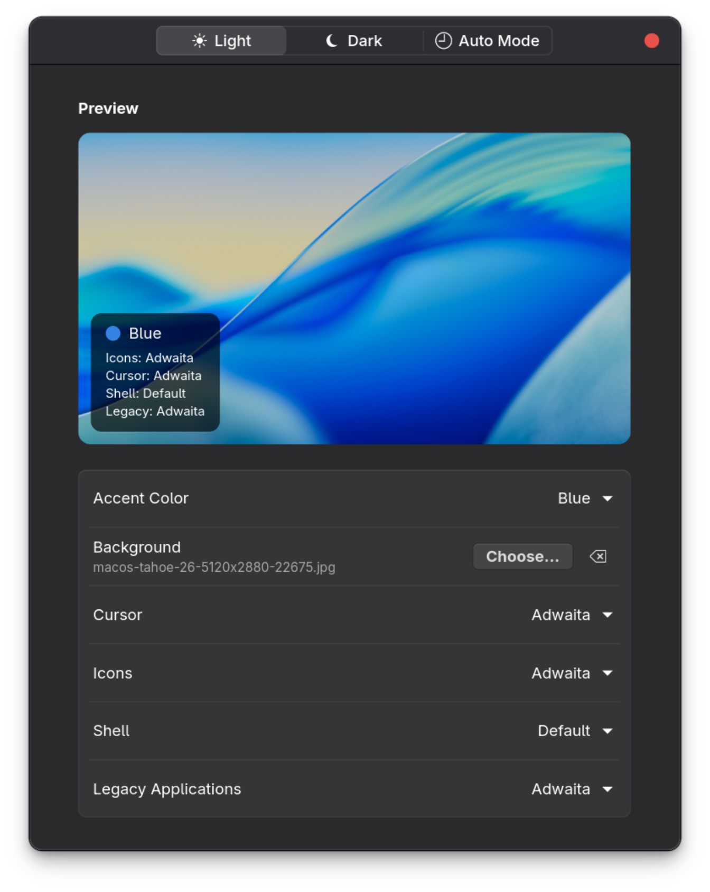

# GNOME Theme Manager

A GNOME Shell extension that applies a saved theme profile whenever GNOME switches between **light** and **dark** mode, either manually or on a time schedule.

Tested on Fedora Workstation with GNOME 51. Declared compatible with GNOME Shell 47 to 51; versions other than 51 are untested, so feel free to try them and report back.



## Features

Each of the **Light** and **Dark** tabs has its own profile:

| Setting | What it changes |
|---|---|
| Preview | Live preview of the wallpaper, accent colour and chosen themes (display only) |
| Accent Color | System accent colour (`org.gnome.desktop.interface accent-color`) |
| Background | Wallpaper (`picture-uri` and `picture-uri-dark`) |
| Cursor | Cursor theme |
| Icons | Icon theme |
| Shell | GNOME Shell theme (needs the User Themes extension) |
| Legacy Applications | GTK3 / legacy application theme |

Every menu has an **Unchanged** option, so the extension only touches the settings you choose.

The **Auto Mode** tab has an on/off switch plus a light-mode time and a dark-mode time, based on the system clock.

### When the profile is applied

- When you log in
- Whenever the dark/light mode changes, from Quick Settings, GNOME Settings or Auto Mode
- Shortly after you edit the profile of the currently active mode

Auto Mode only acts when a switch time is crossed, so a manual switch in the middle of a period is not overridden. It also catches up after suspend.

## Requirements

- GNOME Shell 47 or newer (the accent colour setting was added in GNOME 47)
- [User Themes](https://extensions.gnome.org/extension/19/user-themes/) extension, only if you want to switch the Shell theme.
  On Fedora: `sudo dnf install gnome-shell-extension-user-theme`

Themes and icons are looked up in the standard locations:

- `~/.themes`, `~/.icons`
- `~/.local/share/themes`, `~/.local/share/icons`
- `/usr/share/themes`, `/usr/share/icons` (and the other system data dirs)

## Installation

```bash
git clone https://github.com/itsarman001/gnome-theme-manager.git
cd gnome-theme-manager
./install.sh
```

Log out and back in (required on Wayland), then:

```bash
gnome-extensions enable gnome-theme-manager@itsarman001
gnome-extensions prefs gnome-theme-manager@itsarman001
```

## Development

Source files live in the repo root; `install.sh` copies them to
`~/.local/share/gnome-shell/extensions/gnome-theme-manager@itsarman001/` and compiles the schema.

| You changed | Reload by |
|---|---|
| `prefs.js` | Closing and reopening the preferences window |
| `extension.js`, `lib.js`, `metadata.json` | Logging out and back in |
| The `.gschema.xml` | Running `glib-compile-schemas schemas/` (or `./install.sh`), then logging out and in |

View logs with:

```bash
journalctl -f -o cat /usr/bin/gnome-shell
```

### Structure

```
extension.js   Shell-side logic: watches color-scheme, schedule timer, applies profiles
prefs.js       Preferences UI (Light, Dark and Auto Mode tabs)
lib.js         Shared helpers: theme scanning and profile applying
schemas/       GSettings schema for the extension's own settings
install.sh     Local install helper
```

## Known limitations

- Shell theme switching does nothing unless the User Themes extension is installed and enabled.
- Only GTK3 / legacy themes are switched. libadwaita (GTK4) apps follow the accent colour and dark/light mode but ignore custom GTK themes.
- On Wayland, changes to `extension.js` need a re-login to take effect.

## License

GPL-2.0-or-later. See [LICENSE](LICENSE).
